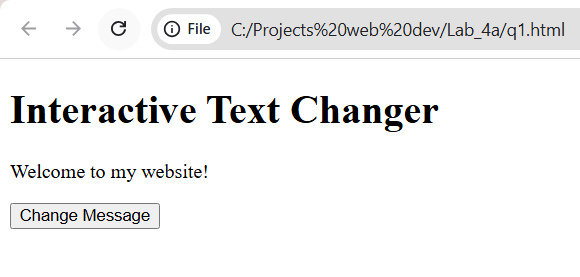
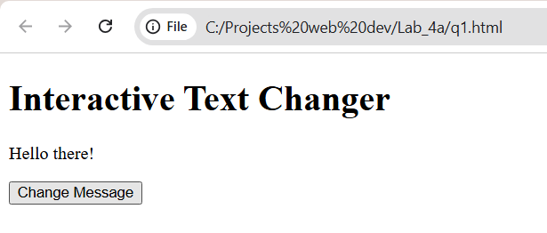
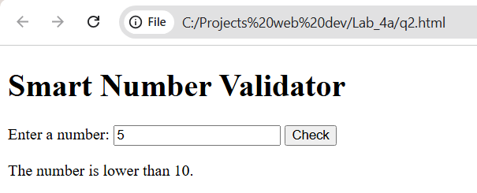
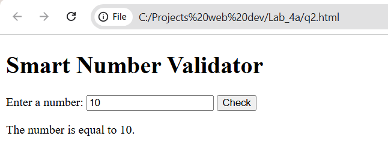
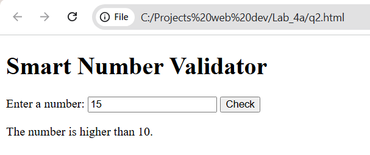
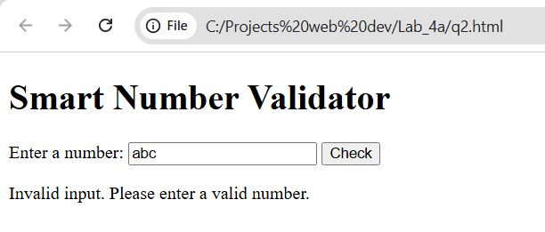
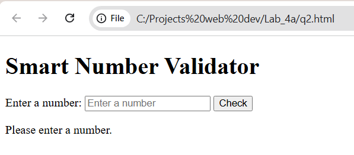
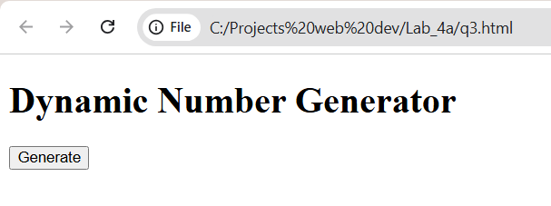
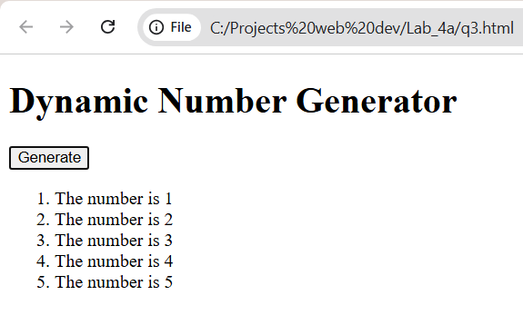

# BIC21203 Lab 4a - Client-Side Scripting (JavaScript)

**Name:** Lim Xi Horng
**Student ID:** AI240130

## About

This repository contains my solutions for Lab 4a. Each question is in its own HTML file and uses plain HTML5 and JavaScript. Events are registered with `addEventListener()`, and all text is updated with `textContent`.

## How to Run

Open `q1.html`, `q2.html` or `q3.html` in a desktop browser (Run > Starting Debugging > Web App (Chrome)). No installation or server is needed.

---

## Q1 - Interactive Text Changer

**Explanation:** The page shows "Welcome to my website!". When the "Change Message" button is clicked, the function `changeMessage()` replaces the paragraph text with "Hello there!" using `textContent`.

**Run:** open `q1.html`, then click **Change Message**.

| Before click | After click |
|---|---|
|  |  |

---

## Q2 - Smart Number Validator

**Explanation:** The function `checkInput()` reads the input, trims spaces and treats empty input as invalid. It converts the text with `Number()`, rejects non-numbers such as `abc` and uses `if...else` to show whether the number is lower than, higher than or equal to 10. The message is shown in `#result` using `textContent`.

**Run:** open `q2.html`, type a value, then click **Check**.

| Input | Expected output | Screenshot |
|---|---|---|
| 5 | The number is lower than 10 |  |
| 10 | The number is equal to 10 |  |
| 15 | The number is higher than 10 |  |
| abc | Please enter a valid number! |  |
| (empty) | Please enter a valid number! |  |

---

## Q3 - Dynamic Number Generator

**Explanation:** The function `generateNumbers()` first clears the list, then uses a `for` loop from 1 to 5. In each loop it creates an `<li>` with `document.createElement()`, sets its text with `textContent` and appends it to `#numberList`. 

**Run:** open `q3.html`, then click **Generate**.

| Before click | After click |
|---|---|
|  |  |